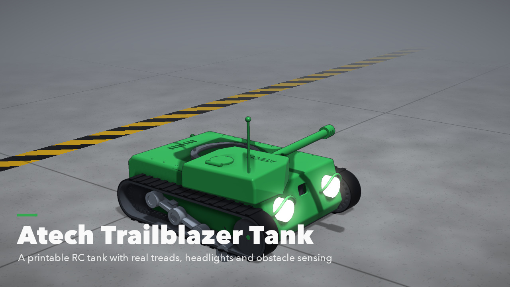
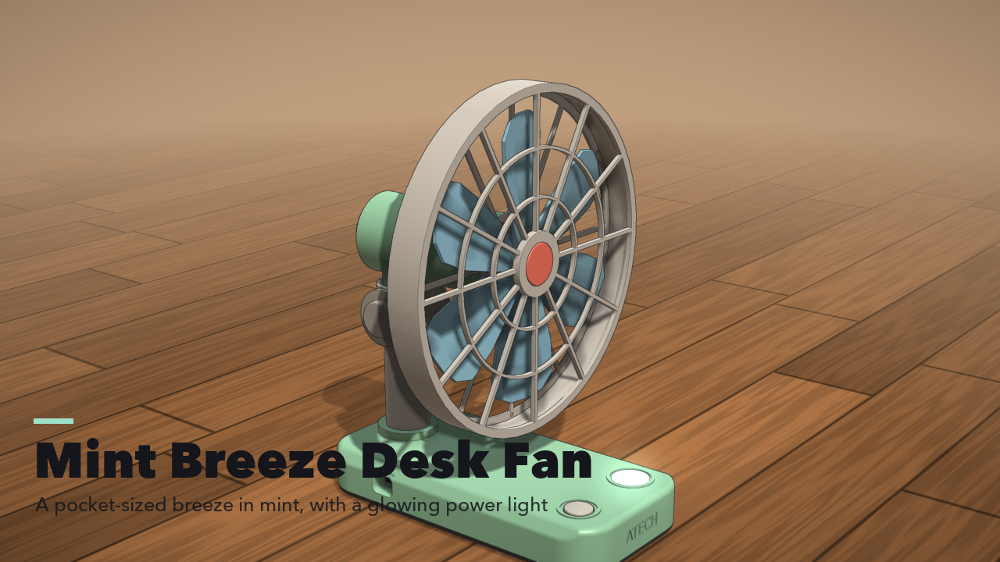
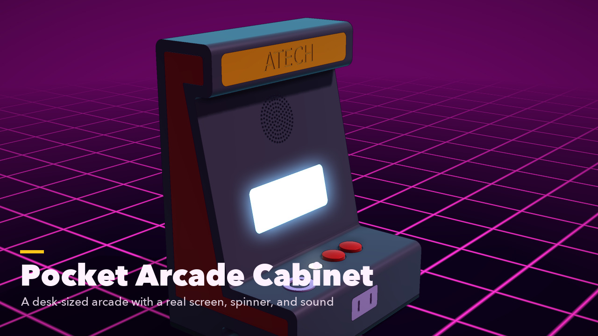
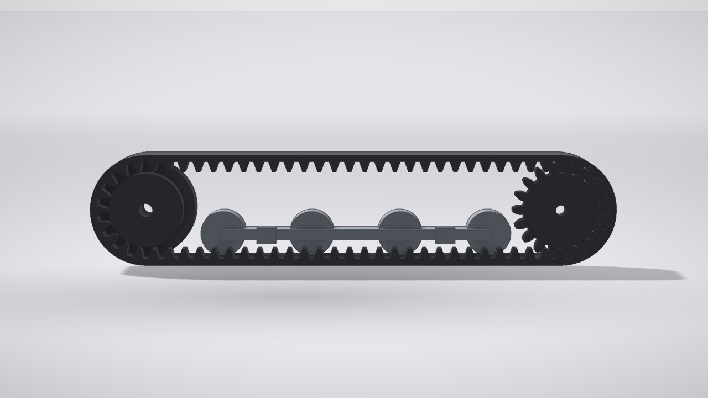
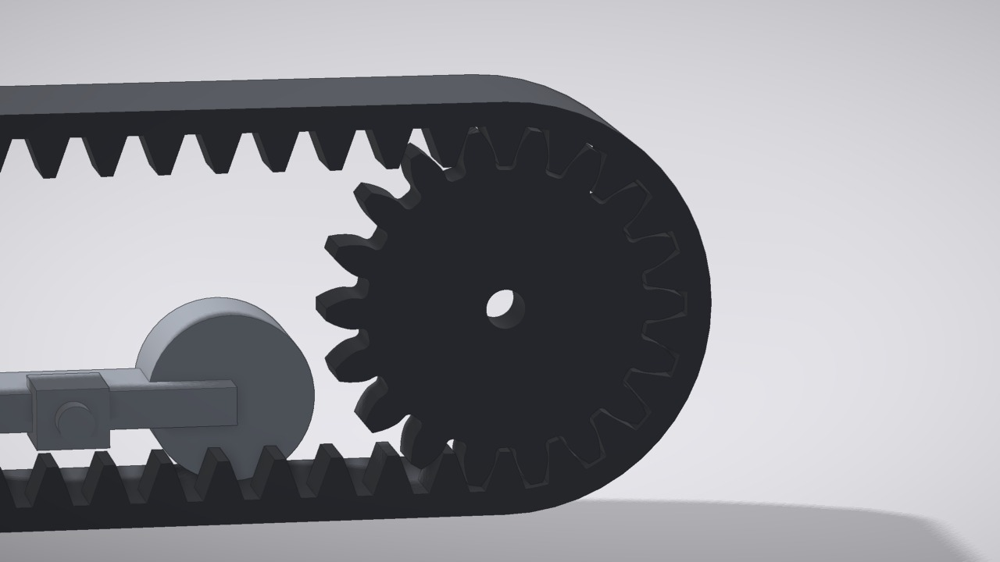

# Assembly videos

Videos Atech AI CAD made of its starter projects: a few seconds of the
finished product, then it goes together part by part, from the Atech board
and its modules to the last screw. Every build makes one like these (see
**Settings > Video**).

To download, open a video below and press the download button (↓), or
right-click the link and choose **Save Link As…**. They are 1280×720 H.264
MP4, about 25 seconds and 12–14 MB each.

| | Product | Setting | Download |
|---|---|---|---|
| [](rc_tank.mp4) | **Atech Trailblazer Tank** (RC tank) | Workshop floor | [rc_tank.mp4](rc_tank.mp4) |
| [](desk_fan.mp4) | **Mint Breeze Desk Fan** (desk fan) | Wooden desk | [desk_fan.mp4](desk_fan.mp4) |
| [](mini_arcade.mp4) | **Pocket Arcade Cabinet** (mini arcade) | Synthwave neon | [mini_arcade.mp4](mini_arcade.mp4) |

The tank's tracks are toothed belts that the motor's sprocket really
drives. Every build now checks that its gears mesh:

| The left track, hull hidden | The sprocket in the belt's teeth |
|---|---|
|  |  |

All three in one go:
[download the repository as a ZIP](https://github.com/atechdotdev/atech-atelier/archive/refs/heads/main.zip)
and open `docs/videos`, or with git:

```sh
git clone --depth 1 https://github.com/atechdotdev/atech-atelier.git
open prompt-to-product/docs/videos
```
